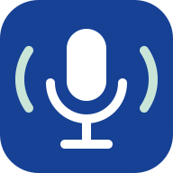

<p align="center">
  
</p>

<h1 align="center">Clindy</h1>

<p align="center">
  Application Android qui enregistre les réunions et les notes vocales des
  collaborateurs Clinitex et en tire un compte rendu prêt à partager.
</p>

---

## En deux mots

**Clindy** enregistre une réunion (RDV commercial, réunion interne, COPIL) ou
une dictée courte, la **transcrit sur le téléphone**, reconnaît **qui parle**,
puis fait rédiger un **compte rendu structuré par Claude**.

La transcription et l'identification des intervenants se font **100 % en
local** : aucun son ne quitte le téléphone. Seul le texte de la transcription
part vers un **webhook n8n Clinitex**, qui appelle Claude et renvoie le compte
rendu. Sans réseau, la synthèse est **mise en file** et part toute seule dès
que le téléphone retrouve une connexion.

Depuis la 1.2.0-beta, une **variante en ligne** peut être choisie dans les
Réglages : l'audio est alors transcrit par **Mistral Voxtral** (via le même
serveur n8n), par tranches de 10 minutes envoyées pendant l'enregistrement.

## À quoi ça sert

- Sortir d'un **RDV commercial** avec un compte rendu propre : besoin du
  client, prestations, objections, suite à donner.
- Garder une trace des **réunions internes** : décisions, actions,
  responsables, échéances.
- **Dicter une note** entre deux rendez-vous et la retrouver mise au propre,
  avec sa liste « À faire ».
- Partager le résultat en un geste (Outlook, Teams…) via la feuille de partage
  Android.

## Ce que voit l'utilisateur

Trois onglets : **Réunions · Vocaux · Réglages**.

1. **Réunions** : choisir un modèle de compte rendu, lancer l'enregistrement,
   l'arrêter. Le détail de la réunion affiche le compte rendu, la
   transcription par intervenant (« Intervenant 1 », renommable en
   « Commercial Clinitex », « Prospect »…), le lecteur audio, et les boutons
   **Copier**, **Partager** et **Relancer la synthèse**.
2. **Vocaux** : un grand bouton **« Appuyez pour dicter »**. Chaque note a deux
   vues : **Note au propre** et **Transcription brute**.
3. **Réglages** : modèle de compte rendu par défaut, micro d'enregistrement
   (micro USB externe ou micro du téléphone), affichage des intervenants,
   dictionnaire de mots personnalisés (ex. « autolaveuse »), moteur de
   transcription (**Parakeet sur le téléphone**, par défaut, ou **Voxtral en
   ligne**).

Avant chaque enregistrement (réunion ou vocal), une fenêtre demande de cocher
**« Les participants ont été informés de l'enregistrement »** ; l'heure de cette
confirmation est enregistrée avec la réunion.

L'état de la synthèse est visible sur chaque élément : **en attente de réseau**
→ **en cours** → **terminée** (ou **échec**, avec relance possible).

## Modèles de compte rendu

| Modèle | Sections principales |
|---|---|
| Réunion générale | Synthèse, points clés, décisions, actions à mener |
| RDV commercial | Synthèse du rendez-vous, contexte du client, … *(sections à valider)* |
| Réunion interne | Synthèse, points abordés, décisions, actions, points ouverts |
| Note vocale | Note, À faire *(réservé à l'onglet Vocaux)* |

## Comment ça marche (principe)

```
┌──────────────────────── Téléphone (hors ligne) ────────────────────────┐
│ micro 16 kHz ─► découpage parole (Silero VAD) ─► transcription         │
│                                                  (Parakeet TDT 0.6B v3) │
│ à l'arrêt : qui parle quand (pyannote + TitaNet-S) ─► « Intervenant N »│
│ stockage local (Room) : réunion, transcription, intervenants            │
└──────────────────────────────────┬──────────────────────────────────────┘
                                   │ dès que le réseau est là (WorkManager)
                                   ▼
                    ┌──────────────────────────────┐        ┌──────────────┐
                    │ webhook n8n Clinitex         │ ─────► │ Claude Haiku │
                    │ (vérifie le jeton d'appareil)│ ◄───── │ (API)        │
                    └──────────────────────────────┘        └──────────────┘
                                   │ { title, notes }
                                   ▼
                     compte rendu affiché dans l'app
```

- **Reconnaissance vocale locale** : Parakeet TDT 0.6B v3 (int8, multilingue)
  via **sherpa-onnx**. Le modèle (~670 Mo) est téléchargé au premier
  lancement (Hugging Face, avec repli sur un miroir).
- **Intervenants** : diarisation locale à la fin de l'enregistrement. Au-delà
  de 10 min, traitement **par fenêtres de 10 min** pour tenir en mémoire sur
  les téléphones modestes, avec raccord des voix d'une fenêtre à l'autre.
- **Synthèse différée** : file WorkManager avec contrainte réseau. **Aucune
  clé API dans l'APK** : la clé Anthropic vit uniquement dans les credentials
  n8n.
- **Rien n'est conservé côté serveur** : n8n renvoie `{title, notes}` et c'est
  tout (sauvegarde des exécutions réussies désactivée dans le workflow). Le
  compte rendu ne vit que dans l'app.
- **Dictionnaire** : les mots du dictionnaire de moins de 6 lettres (sigles,
  noms courts) ne sont remplacés que s'ils sont entendus exactement ; la
  correction approchée est réservée aux mots longs.

### Variante Voxtral (transcription en ligne)

- Choix dans **Réglages › Modèle de transcription** ; la fenêtre de
  consentement indique alors que l'audio est transcrit par Mistral AI.
- L'enregistrement est découpé en **tranches de 10 min**, chacune reprenant les
  **30 dernières secondes** de la précédente. Chaque tranche part dès qu'elle
  est complète (FLAC sans perte, ≈ 10 Mo), la dernière à l'arrêt ; hors réseau,
  elles attendent dans une file WorkManager.
- Mistral (`voxtral-mini-transcribe-3`) renvoie le texte par intervenant. Le
  téléphone raccorde les tranches : coupe sur une pause commune dans le
  recouvrement, et intervenants reliés d'une tranche à l'autre par
  recouvrement puis empreinte vocale TitaNet-S (calculée sur le téléphone).
- La clé Mistral vit uniquement dans n8n (workflow « Clindy - Transcription
  Voxtral », qui transmet le fichier tel quel et ne sauvegarde aucune
  exécution). L'audio d'une réunion en attente d'envoi n'est pas supprimé
  avant d'être transcrit.

> 🔒 **Confidentialité** : avec Parakeet (par défaut), l'audio et la
> transcription restent sur le téléphone. Seul le texte part vers n8n au
> moment de la synthèse. Avec Voxtral, l'audio est envoyé à Mistral AI.
> L'audio est **supprimé automatiquement 48 h** après la fin de
> l'enregistrement (purge toutes les heures et à chaque lancement) ; la
> transcription et le compte rendu restent dans l'app.

## Configuration (développeur uniquement)

L'utilisateur final **ne saisit rien**. L'URL du webhook et le jeton
d'appareil sont injectés à la compilation via **`local.properties`**
(gitignoré) ou des propriétés Gradle `-P`.

| Clé | Rôle |
|---|---|
| `clinitex.summaryUrl` | URL du webhook n8n de synthèse |
| `clinitex.deviceToken` | Jeton envoyé dans l'en-tête `X-Clinitex-Device-Token` |
| `clinitex.dictionaryUrl` | URL du webhook n8n du dictionnaire commun |
| `clinitex.transcriptionUrl` | URL du webhook n8n Voxtral (vide : le choix Voxtral n'apparaît pas) |
| `clinitex.release.storeFile` | Chemin du keystore Clinitex (hors dépôt) pour signer la release |
| `clinitex.release.storePassword` / `keyPassword` | Mots de passe du keystore et de la clé |
| `clinitex.release.keyAlias` | Alias de la clé (`clindy`) |

```properties
clinitex.summaryUrl=https://…/webhook/…
clinitex.deviceToken=…
```

> Ne jamais committer `local.properties` ni le keystore (`*.jks` est ignoré par git).
> Sans les clés `clinitex.release.*`, la release est signée avec la clé de debug.

### Contrat du webhook

`POST {clinitex.summaryUrl}` avec l'en-tête `X-Clinitex-Device-Token`.

```json
{
  "sessionId": "uuid",
  "title": "RDV Résidence Les Tilleuls",
  "templateId": "rdvCommercial",
  "templateInstructions": "…",
  "speakerNames": { "1": "Commercial Clinitex", "2": "Prospect" },
  "manualNotes": "…",
  "transcript": "Intervenant 1 · 0:04\n…",
  "durationSec": 2710,
  "appVersion": "1.2.0-beta"
}
```

Réponse `200` : `{ "title": "Titre court", "notes": "## Synthèse\n…" }`

## Pour les développeurs

### Pile technique
- Kotlin + **Jetpack Compose** (Material 3), charte Clinitex (polices AZO Sans
  Uber et Sofia Pro Soft, thème clair)
- **sherpa-onnx** : Silero VAD, Parakeet TDT 0.6B v3, pyannote segmentation
  3.0, TitaNet-S
- **Room** (sessions, transcriptions, segments par intervenant, noms donnés)
- **WorkManager** (synthèse différée) + **OkHttp** + `kotlinx.serialization`
- **BuildConfig** (URL + jeton via Gradle)
- minSdk 24 / targetSdk 36 · JDK 17 · **arm64-v8a uniquement** (pas de libs
  natives x86_64)

### Build
```bash
./gradlew assembleDebug testDebugUnitTest   # APK dans app/build/outputs/apk/debug/
adb install -r app/build/outputs/apk/debug/app-debug.apk
```

### Structure
```
clindy/
├── app/src/main/java/fr/clinitex/transcription/
│   ├── meetings/     # service d'enregistrement, diarisation, modèles de compte rendu
│   ├── engine/       # chargement partagé de Parakeet (sherpa-onnx)
│   ├── model/        # téléchargement reprenable des modèles
│   ├── summaries/    # client du webhook n8n, SummaryWorker
│   ├── voxtral/      # variante en ligne : tranches, FLAC, client Voxtral, raccord
│   ├── data/         # Room (entités, DAO, migrations)
│   ├── ui/           # écrans Compose (Réunions, Vocaux, Réglages, enregistrement)
│   ├── theme/        # charte Clinitex
│   └── utils/        # dictionnaire métier, suppression des « euh »
├── app/src/main/assets/models/   # VAD, segmentation, empreintes vocales (embarqués)
├── app/src/main/jniLibs/arm64-v8a/  # runtime sherpa-onnx / onnxruntime
└── app/schemas/      # schémas Room exportés (migrations)
```

## Avancement

| Lot | Contenu | État |
|---|---|---|
| 1 | Synthèse différée via n8n | ✅ |
| 2 | Modèles de compte rendu en français | ✅ |
| 3 | Intervenants nommables | ✅ |
| 4 | Robustesse mémoire sur réunions longues + calibration des intervenants | ✅ (test d'1 h en conditions réelles à faire) |
| — | Onglet Vocaux, charte Clinitex | ✅ |
| 5 | Consentement avant enregistrement, suppression auto des audios, signature release, package `fr.clinitex.transcription` | ✅ (hébergement des modèles Parakeet : à décider) |
| 6 | Dictionnaire commun Clinitex (n8n), reprise automatique des synthèses + « Forcer la reconnexion », audio conservé 48 h | ✅ |
| 7 | Variante Voxtral (transcription en ligne par tranches de 10 min), dictionnaire plus strict sur les mots courts | ✅ (calibrage du raccord sur de vrais RDV à poursuivre) |

> ℹ️ **Version bêta** : package `fr.clinitex.transcription`, release signée
> avec la clé Clinitex. Distribution interne uniquement.

## Origine et licence

Clindy est un fork de [Muesli Android](https://github.com/Muesli-HQ/muesli-android)
(licence MIT). Le fichier [`LICENSE`](LICENSE) et la mention de copyright
Muesli sont conservés, comme l'exige la licence.

---

<p align="center"><sub>Clinitex — application interne · Clindy v1.2.0-beta</sub></p>
